#  Scalable Capital Integration for Home Assistant - your broker portfolio as sensors and as a card

[](https://my.home-assistant.io/redirect/marketplace_repository/?owner=somansch&repository=scalable&category=Integration)
[](https://www.home-assistant.io/)
[](https://github.com/somansch/scalable/blob/main/LICENSE)
[](https://github.com/somansch/scalable/releases)
[](https://github.com/somansch/scalable/releases/latest)
[](https://github.com/somansch/scalable/releases/latest)
[](https://buymeacoffee.com/ou4lgpvlju)

**Available languages:** English, Deutsch, Français, Italiano, Español, Nederlands

> **Unofficial.** Not affiliated with, endorsed by or supported by Scalable Capital. "Scalable" and its logo are trademarks of Scalable Capital GmbH.

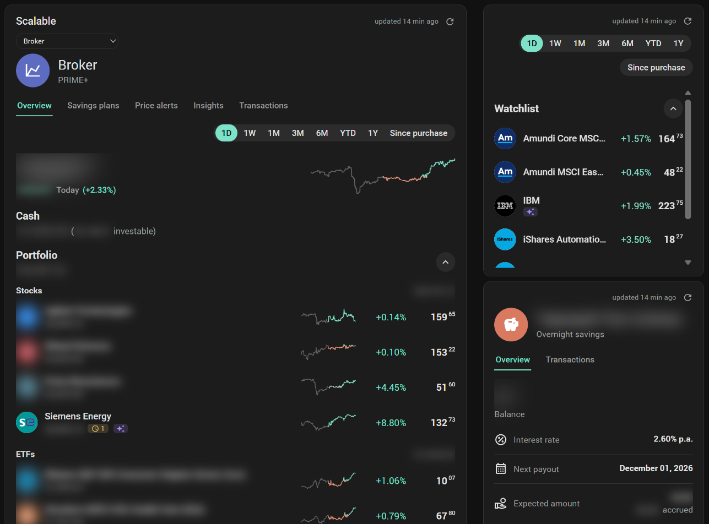

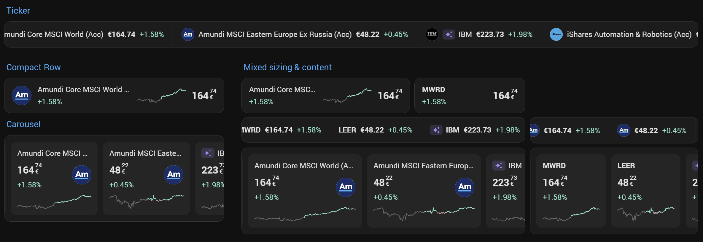

## Overview

Checking on a portfolio usually means opening the broker's app. This integration brings a Scalable Capital broker portfolio into Home Assistant in addition, laid out the way Scalable's own web app lays it out: the overview with its balance, every position with what it cost and what it has made, the watchlist, the price alerts and the transactions - and beside the broker the overnight savings account, the fixed-term deposits and the securities credit line.

It reads through **Scalable MCP**, the connection Scalable offers to AI assistants - Scalable publishes no other interface for software that is not its own app. Home Assistant already ships what is needed to talk to it, so there is no add-on and no extra program to install.

Typical reasons to use it:

- **See the portfolio on a dashboard.** The [Scalable card](#scalable-card) comes with the integration and reads like Scalable's web app: the same tabs, the same period switch, a page per security and per order. Nothing to download and no resource to register.
- **Keep an eye on it in one line.** The [Scalable Ticker card](#scalable-ticker-card) runs through the positions and the watchlist as a running ticker, a compact row or a carousel, and opens a security's page in a pop-up.
- **Know what a position has made.** Value, purchase value, average price and the unrealised return for every position - a figure Scalable does not report on its own and the integration works out from the transactions.
- **See the savings and the credit too.** The overnight account, every fixed-term deposit and the credit line, as sensors and as pages of the card, one dropdown away from the broker.
- **Follow the watchlist and the price alerts** without opening the app: a price and today's change per entry, and how far each alert still is from the current price.
- **Use the figures anywhere.** Every value is a plain sensor, so history graphs, statistics, templates and automations work as with any other sensor.
- **Keep it apart by product and kind.** The broker, the overnight account, the fixed-term deposits and the credit line each get a group on the integration page; every kind of security - stocks, ETFs, … - gets one beside the broker's, and a value of its own.
- **Look, nothing more.** It only reads - see [Reading only](#reading-only) for what that rests on.

**Questions, feedback, or just want to see what others are doing with it?** Join the discussion on the [Home Assistant Community thread](https://community.home-assistant.io/t/scalable-capital-bring-your-broker-depot-into-home-assistant/1027344).

## Quick start

1. In Scalable's **web** version, switch on **Scalable MCP** ([Before you start](#before-you-start)).
2. **Install** via [Marketplace (HACS)](#marketplace-hacs) or [manually](#manual), then restart Home Assistant.
3. **Settings → Devices & Services → Add Integration**, search for "Scalable Capital", give the entry a name and sign in to Scalable ([Setting up](#setting-up)).
4. Put it on a dashboard: **Add card → Scalable Capital** gives you the [card that comes with the integration](#scalable-card), **Scalable Capital Ticker** its [ticker](#scalable-ticker-card). Or use the [sensors](#created-entities) in any card you like.

That is the whole setup. Everything below covers the individual parts in more depth.

## Quick links

**Setting up**

- [Before you start](#before-you-start) - switching on Scalable MCP, and the access level
- [Setting up](#setting-up) - the name, and signing in to Scalable
- [Configure](#configure) - the update interval, removing what Scalable no longer lists, signing in again

**How the portfolio arrives**

- [Created entities](#created-entities) - every sensor and every attribute, for your own templates
  - [Broker](#broker), [A position](#a-position), [Overnight, fixed-term and credit](#overnight-fixed-term-and-credit), [Watchlist](#watchlist), [Price alerts](#price-alerts)
- [Automation examples](#automation-examples)
  - [Use in your own automations](#use-in-your-own-automations) - the entities an automation reads, a long interval with a refresh on demand
  - [The refresh action](#the-refresh-action) - `scalable.refresh`, with its answer

**Showing it on a dashboard**

- [Scalable card](#scalable-card) - the card that comes with the integration
  - [Overview](#overview-1), [A security's page](#a-securitys-page), [Price alerts and savings plans](#price-alerts-and-savings-plans), [Transactions](#transactions), [Insights](#insights), [Overnight savings, fixed-term deposits and credit](#overnight-savings-fixed-term-deposits-and-credit)
  - [Settings](#settings) - the editor
  - [What differs from the web app](#what-differs-from-the-web-app)
- [Scalable Ticker card](#scalable-ticker-card) - the securities as a running ticker, a compact row or a carousel
  - [What it goes through](#what-it-goes-through), [An entry](#an-entry), [The pop-up](#the-pop-up), [How it moves](#how-it-moves), [Settings](#settings-1)

**Background**

- [Reading only](#reading-only)
- [Logos and short names](#logos-and-short-names) - the two services Home Assistant asks, and what it sends them
- [Good to know](#good-to-know)
- [Installation](#installation)
- [Help and Contribution](#help-and-contribution)
- [Disclaimer](#disclaimer)

## Before you start

You need a Scalable Capital broker account with **Scalable MCP** switched on. It is found in Scalable's **web** version, not in the app, under **Profile → Security → Agentic Investing**.

Set its **access level** to **Read only** unless you also trade through an AI assistant. The level is the account's, not this integration's: it applies to every connection of your account, Home Assistant's included.

## Setting up

**Settings → Devices & Services → Add Integration → Scalable Capital**

1. **Name.** Suggested as *Scalable*. It becomes the entry's title and the start of every entity id (`sensor.scalable_…`) and device name. A second Scalable account needs a name of its own.
2. Submitting registers this Home Assistant with Scalable - a name and a return address, nothing about you.
3. **Sign in to Scalable.** Open the link, sign in, confirm the second factor and authorise **Home Assistant**. Your browser then lands on a page that **does not load**; its address starts with `http://127.0.0.1:47861`. That is expected: Scalable only lets an application return to the computer the browser runs on. Copy the whole address from the address bar and paste it into the form. It works once and only for a few minutes.

That is done once. The sign-in is renewed in the background from then on; when Scalable ends it, Home Assistant asks you to sign in again - under Settings → Repairs - and the card says so: its update time and its refresh symbol turn red until that is done, and the Insights curves grey the stretch nothing was read for.

An account with more than one portfolio is asked which one; each portfolio is an entry of its own.

## Configure

The gear on the integration page:

- **Settings** - the update interval in minutes, 5 to 1440, 15 by default; and **Remove what Scalable no longer lists**. Switched on, a sold position, an entry taken off the watchlist, a deleted price alert and a savings product that is gone - a matured fixed-term deposit, a closed overnight account or credit line - are removed from Home Assistant with the next update - devices, entities, the history recorded for them and their long-term statistics. Off, which is the default, they stay and read *unavailable*.
- **Sign in to Scalable again** - for instance after changing the access level in Scalable.

**Overnight account ids.** Scalable used to name its overnight accounts while it refused to pick one. Since the end of October 2026 it picks the personal account by itself and refuses the others - a child's junior account, say - even by their id ("not accessible"). Ids typed here, comma-separated, are asked for on every update like the ones found, and their accounts come in by themselves once Scalable gives them out again. An id is in the integration's debug log from an earlier refusal.

## Created entities

The integration page groups the devices:

| Group | Devices |
|---|---|
| **Broker** | *‹Name› Broker*, *‹Name› Watchlist*, *‹Name› Price alerts* |
| **Broker · Stocks**, **Broker · ETFs**, … | one device per position, under its kind of security |
| **Overnight savings** | one device per overnight account Scalable gives out |
| **Fixed-term deposits** | one device per fixed-term account |
| **Credit** | *‹Name› Credit* |

A group appears when it is first needed - a kind of security with the first position of that kind, a product when the account has it. Home Assistant shows one level of groups, which is why a kind of security stands beside the broker's group rather than inside it. Groups can be renamed; the groups of an earlier version are carried over.

Entity ids below assume the name *Scalable*.

### Broker

| Entity | What it is |
|---|---|
| `sensor.scalable_portfolio_total` | Total value, cash included |
| `sensor.scalable_portfolio_cash` | Cash balance; attributes `buying_power`, `pending_buy_orders` |
| `sensor.scalable_portfolio_securities` | Value of all securities |
| `sensor.scalable_portfolio_crypto` | Value of all crypto |
| `sensor.scalable_portfolio_change_day` / `_week` / `_month` / `_3_months` / `_6_months` / `_ytd` / `_year` / `_since_buy` | The change in euros per period, as the web app's switch shows it |
| `sensor.scalable_portfolio_invested` | Purchase value of all positions |
| `sensor.scalable_portfolio_return` / `_return_pct` | Unrealised return of all positions |
| `sensor.scalable_portfolio_type_stock`, `_type_etf`, … | Value per kind of security; attributes `positions`, `names`, `share_pct`, `invested`, `return`, `return_pct` |
| `sensor.scalable_last_update` | When Scalable was last read successfully (diagnostic) |
| `number.scalable_update_interval` | Minutes between two reads - the entry's option, settable here too (configuration) |
| `button.scalable_refresh` | Reads Scalable again now |

### A position

With `‹position›` the security's name, e.g. `sensor.scalable_caterpillar_value`:

| Entity | What it is |
|---|---|
| `…_value` | What the position is worth; attributes `isin`, `type`, `quantity`, `invested` and the change per period for the whole position |
| `…_price` | The current price; attributes `bid`, `ask`, `price_time`, `outdated` and the change per period for one unit |
| `…_quantity` | Units held |
| `…_change_day` | Today's change in percent |
| `…_invested` | Purchase value; attribute `average_price` |
| `…_return` / `…_return_pct` | Unrealised return since purchase |
| `…_open_orders` | Orders that have not run yet; attribute `orders` with side, quantity, limit and stop |

The change per period comes as `change_day`, `change_week`, `change_month`, `change_3_months`, `change_6_months`, `change_ytd`, `change_year`, `change_max`, each also as `…_pct`.

**The purchase value** is not something Scalable reports. It is rebuilt from the transaction history - purchases added, sales taken off at the average price - and then held against the position's quantity. Where the two do not agree, for instance after a securities transfer or a split, the sensors that depend on it read *unknown* rather than a number that only looks right.

A sold position's sensors turn *unavailable*; its device can then be deleted - or is deleted for you, see **Remove what Scalable no longer lists** under [Configure](#configure).

### Overnight, fixed-term and credit

The products beside the broker, each a device of its own: every overnight account Scalable gives out, every fixed-term account and the securities credit line. Rates are in percent per year. The first overnight account keeps the ids below; a further one is told apart by its name and the start of its id, the way a fixed-term account is: `sensor.scalable_overnight_<name>_<id>_balance`.

| Entity | What it holds |
|---|---|
| `sensor.scalable_overnight_balance` | What is on the overnight account; attributes `account_name`, `owner_kind` (`personal` or `junior`), `active`, `interest_bearing`, `lifetime_interest` |
| `sensor.scalable_overnight_interest_rate` | The account's interest rate |
| `sensor.scalable_overnight_accrued` | Interest run up since the last payout; attribute `lifetime_interest` |
| `sensor.scalable_overnight_next_payout` | What the next payout is expected to bring; attribute `next_payout_date` |
| `sensor.scalable_<name>_<id>_amount` | What went into the fixed-term account; attributes `state`, `months`, `start`, `maturity`, `auto_renewal`, `estimated_payout` |
| `…_interest_rate` | The nominal rate; attribute `effective_rate` |
| `…_accrued` | Gross interest run up so far; attribute `estimated_payout` |
| `…_maturity` | When the term ends; attributes `start`, `months`, `auto_renewal` |
| `sensor.scalable_credit_used` / `_line` / `_available` | The securities credit line - what is drawn on it, the line, what is left; each with the three as attributes. Only where a line is set up. Scalable's interface does not give the rate or the next interest date |

An account Scalable no longer lists reads unavailable. Scalable's interface names the personal overnight account by itself. A child's junior account it currently refuses, even by its id; the integration keeps every account id it has seen and asks for it on every update, so such an account comes back by itself once Scalable gives it out again. Fixed-term junior accounts are not offered by Scalable's interface.

### Watchlist

Per entry `sensor.scalable_watchlist_‹name›_price` and `…_change_day`, the price with the same attributes as a position's.

### Price alerts

`sensor.scalable_alerts_active` counts the alerts still waiting (attribute `triggered`). Each alert is a sensor, e.g. `sensor.scalable_alert_caterpillar_785_84`, whose state is the price it waits for; attributes `direction`, `active`, `triggered`, `triggered_time`, and - where the security is a position or on the watchlist - `current_price` and `distance_pct`.

## Automation examples

### Use in your own automations

Every figure is a sensor, so an automation reads it like any other - the ids below assume the name *Scalable*:

| What | Entity |
|---|---|
| Portfolio value | `sensor.scalable_portfolio_total`, with `_securities`, `_crypto` and `_cash` beside it |
| Overnight balance | `sensor.scalable_overnight_balance` per account |
| Fixed-term amount | `sensor.scalable_<account>_amount` per account |
| Credit | `sensor.scalable_credit_used`, `_line`, `_available` |
| Last update | `sensor.scalable_last_update` - when Scalable was last read successfully |
| Update interval | `number.scalable_update_interval` - the entry's option, in minutes |
| Refresh | `button.scalable_refresh` - reads Scalable again now |

A long update interval for the everyday and a refresh when it matters: set the interval under [Configure](#configure) or through the number entity, and have the automation press the button - or call the action below, which also waits for the answer.

### The refresh action

**`scalable.refresh`** reads Scalable again now and waits for it. Called with a response, it answers with the portfolio value, the cash, the balances, the credit line and the moment of the read - so an automation can ask for fresh figures and act on them in the same run. `entry` names the entry, and is needed only when more than one is set up.

```yaml
- action: scalable.refresh
  response_variable: scalable
- condition: template
  value_template: "{{ scalable.portfolio.cash > 1000 }}"
- action: notify.mobile_app_phone
  data:
    message: "Cash at Scalable: {{ scalable.portfolio.cash }} EUR, read {{ scalable.updated }}"
```

The answer: `updated`, `portfolio` (`total`, `securities`, `crypto`, `cash`, `buying_power`, `valuation_time`), `overnight` (a list of `id`, `name`, `balance`, `interest_rate`), `fixed_term` (a list of `id`, `name`, `amount`, `maturity`) and `credit` (`line`, `used`).

## Scalable card

The integration's own card: the portfolio the way Scalable's web app shows it, with the same tabs - **Overview, Savings plans, Price alerts, Insights, Transactions**. Where the account has more than the broker, a dropdown under the title switches to the [overnight savings, a fixed-term deposit or the credit](#overnight-savings-fixed-term-deposits-and-credit), the way the web app's start page offers them. Every product opens with its head: its symbol on a disc, its name and, for the broker, the plan, read off its monthly fee booking.

It comes with the integration. There is nothing to download, nothing to copy into `www` and nothing to register as a dashboard resource - restart Home Assistant after installing and the card is there, under **Scalable Capital** in the card picker - and under **By entity** it is suggested for every entity of the integration; with more than one Scalable account, set to the one the entity belongs to. The entry that shows up under **Settings → Dashboards → Resources** is the integration's own: it writes it, keeps it pointing at the version it serves, and takes it out again with the last entry. In YAML it is just:

```yaml
type: custom:scalable-card
```

The card **only shows**. It has no buttons to buy, sell, cancel an order or set an alert, and the integration behind it cannot do any of that either.

Beside the title stand the time of the last update and a small symbol that reads Scalable again right away instead of waiting for the next one. Both turn red while Scalable waits for a new sign-in, and both stay when the title is hidden - the dropdown then takes the title's line.

### Overview

The total value with its change over the chosen period - **1D, 1W, 1M, 3M, 6M, YTD, 1Y, Since purchase** - in euros and, in brackets after the period's name, in percent - and the portfolio's curve beside it; **Opens with** under **Settings → Content → Broker** says which of the eight the switch offers and which it starts on; a click on the curve opens [Insights](#insights). Below, the cash balance - with what can be invested in brackets where that differs, as with a credit line drawn on - the positions under a heading per kind of security - Stocks, ETFs, … - or, with **Scalable's groups** switched on in place of the kinds and groups made in Scalable's app, under those groups, each folded to its name and value until opened, the positions outside every group under **Ungrouped** - the crypto value and the watchlist.

On a weekend or a holiday the one-day view names the trading day it describes - *Friday*, say - in place of *Today*.

Every entry carries the security's [logo](#logos-and-short-names), its value, its open orders - the clock is a link to them - the amount of its savings plan, a small curve, the change and the price. Where Scalable has [Market Insights](#a-securitys-page) on a security, a sparkle opens them straight from the list. Under *Since purchase* a position shows its return in percent and euros instead. A section folds with a click on its heading.

A security a savings plan saves into stands under **Savings plans**, a heading like the kinds with the value of what stands under it - from the day the plan exists, so before the first run with no value yet. Grouped by kind, every security with a plan stands there, held or not; with Scalable's groups or no grouping, a held one keeps its place. **Savings plans** under **Settings → Content → Broker** switches the heading off.

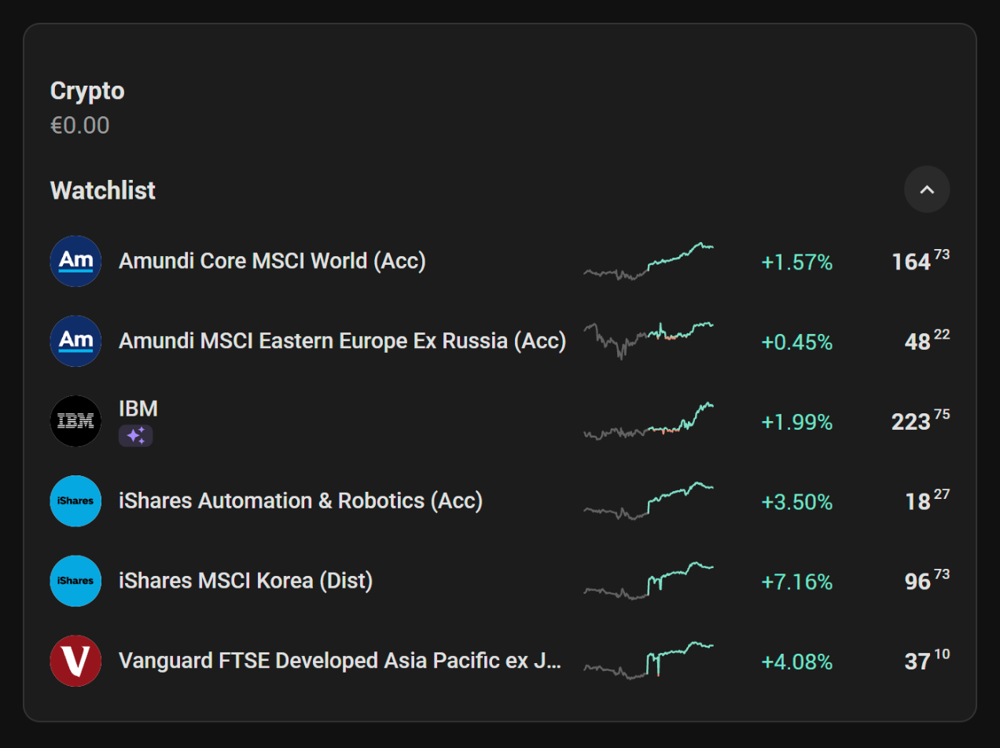

### A security's page

A click on an entry opens the security's own page:

- the price with its change over the chosen period, and the two prices of Scalable's **Sell** and **Buy** buttons;
- **Market Insights**, while Scalable has them: its AI summary of the news about the security in one line, a click away from the whole text and the headlines it was made from, newest first;
- a chart over **1D** to **MAX** that reads off the moment and the price under the pointer and marks the current price at its end, green above the period's starting price and red below it;
- a bell with the number of its waiting price alerts, which leads to them;
- **Your position** - value, purchase value, quantity, average price and unrealised return;
- the security's own transactions and open orders.

While the security cannot be traded - outside weekdays 06:00 to 23:00 German time, the hours Scalable trades in and the charts run on, or once Scalable marks the price as outdated - a moon stands in front of the price; crypto trades round the clock. Once Scalable marks the price as outdated, the one-day view names the day the price is from instead of *Today*.

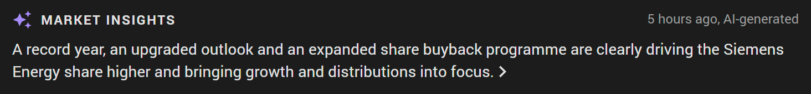

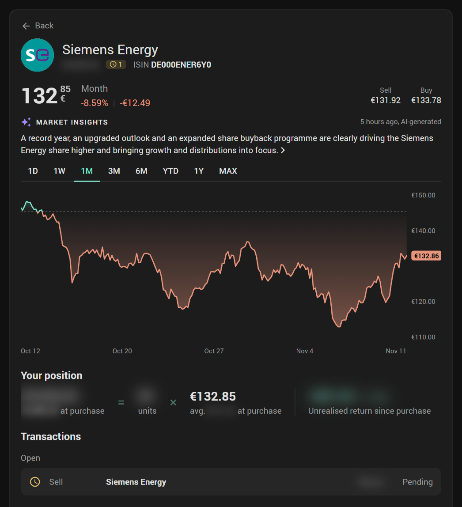 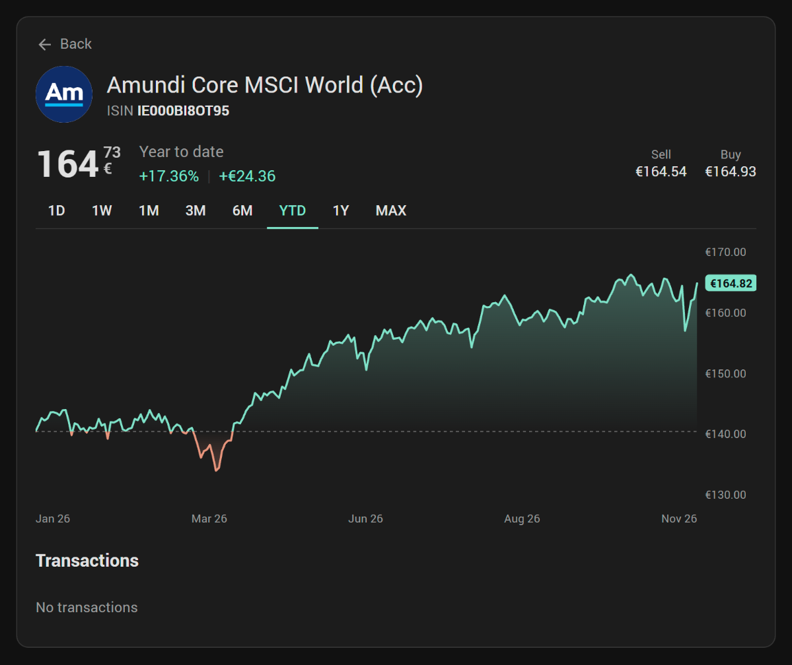

### Price alerts and savings plans

**Price alerts** lists the securities that have alerts. The chosen one shows its price, every alert still waiting with how far it is from the current price, and the ones already triggered with the moment they were reached.

**Savings plans** opens with the monthly savings rate - a plan that runs every two months counts half, a yearly one a twelfth - and lists each plan with a badge for its amount, how often it runs, in how many days it is due and its inflation adjustment where one is set. A search field goes by name and ISIN, and the button beside it sorts by name, savings rate or next run, each either way.

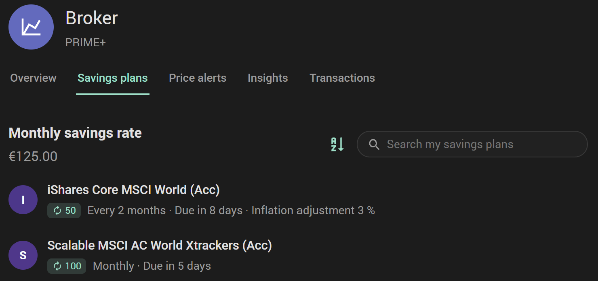

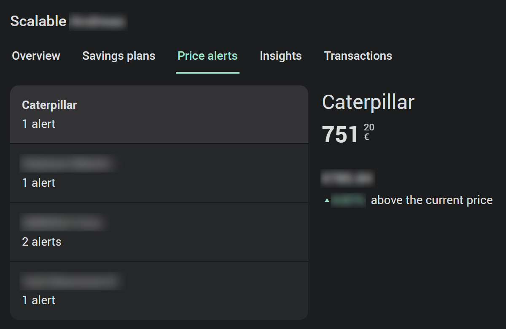

### Transactions

Open orders first, the rest under their day, with a search and three filters as in the web app. **Date** offers the last 7, 30 and 365 days or a span of your own and names what was chosen; **Type** and **Status** are check lists that show how many are ticked. Deposits and withdrawals carry their own symbol, the amount in green or red; a sale's proceeds are green as well.

A click opens the transaction's own page: ordered and executed quantity, limit and stop price with their distance to the current price, validity, trading venue, execution price, amount, the history of the order and the reference Scalable gives it.

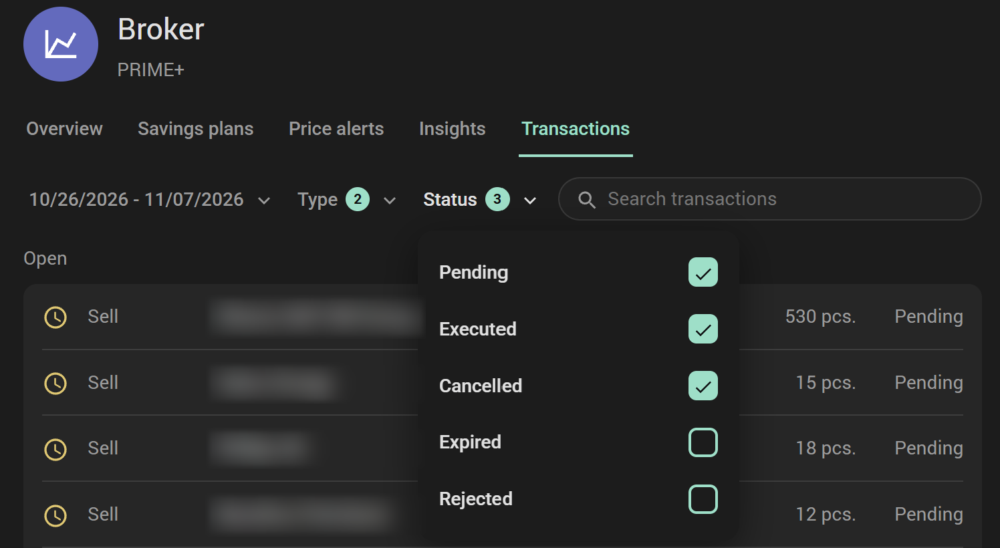

### Insights

The portfolio's **Total return** or **Portfolio value** as a curve, over **1D** to **MAX**. Both curves run on trading time, the way the web app's do - weekdays from 06:00 to 23:00 German time, whatever clock the browser runs on, with no nights and no weekends in them - and every period opens on the close of the day before its first day, which is where the return stands at nought: **1W** a week ago, **1M** the same day a month ago, **YTD** on 1 January. The clock stands still from the close to the next open, so at midnight the charts are what they were at 23:00. **1D** is the trading day before, in grey, and the present one; a period that reaches back before the first record runs flat from its start. Along the bottom a day names its two days, a week its trading days, a month every seventh day and the longer periods their months. The return is drawn the way the web app draws it: from nought at the period's start, with deposits and withdrawals taken out, so a payment into the account is no gain; the curve ends on Scalable's own figure for the period. Both curves come out of the value Home Assistant has recorded for the portfolio.

The pointer reads off the moment and the figure: the time on a day, date and time on a week or a month, the date from three months up. Where nothing was recorded - Scalable waiting for a new sign-in, Home Assistant switched off - the curve breaks and the stretch is grey.

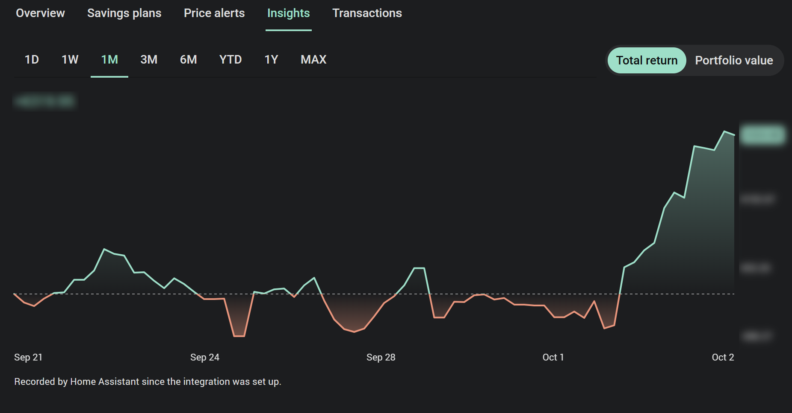

### Overnight savings, fixed-term deposits and credit

**Overnight savings** shows the balance, the interest rate, the next payout and what it is expected to bring, and the account's transactions with a search - under the figures, on a tab of their own, or both.

**A fixed-term deposit** shows its amount, rate and end date, and a ring that runs through the term with the interest run up so far, to nine places: the cents bright, the rest dimmed, as the web app has it.

**Credit** shows what is drawn on the securities credit line, a bar of the line - used against free - and below it what is used, what is left and the line itself.

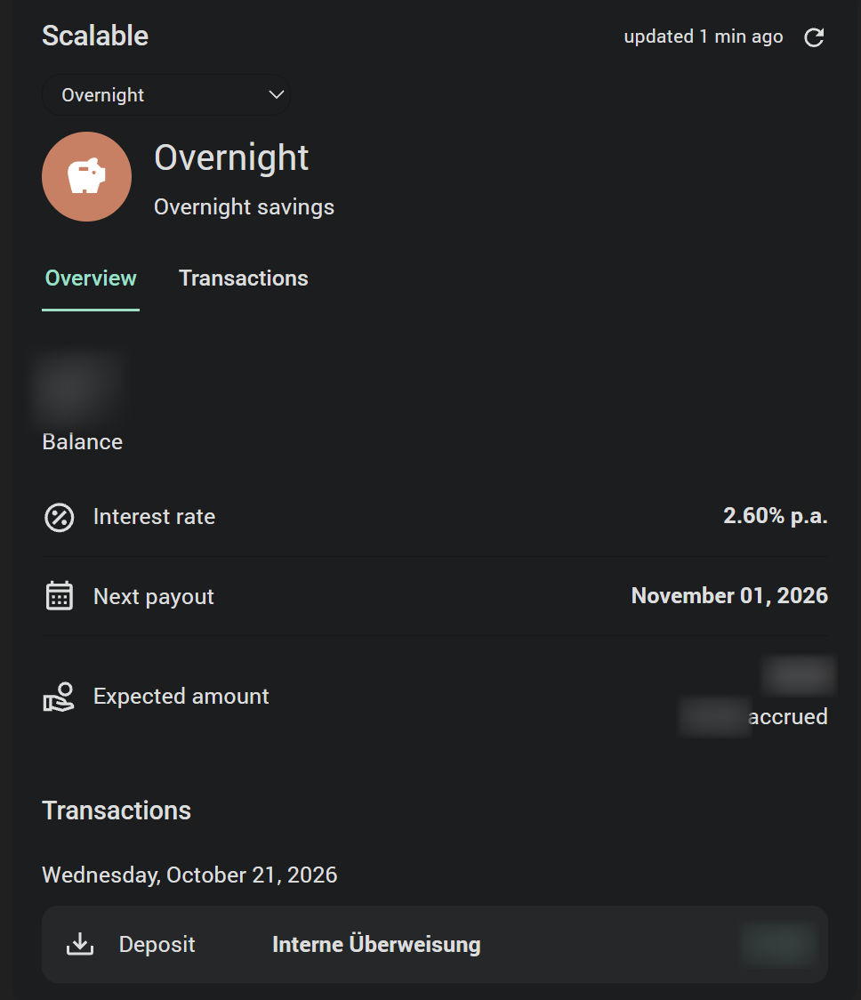 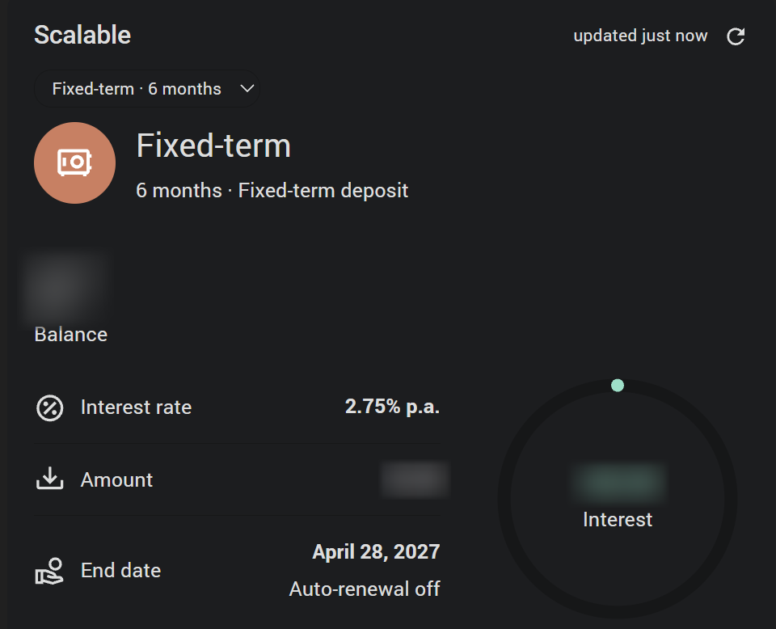 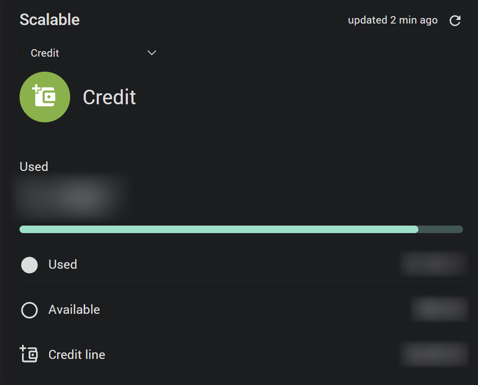

### Settings

The editor has two panels, each with three tabs, the way the Annuals and Blitzer.de cards have them:

- **Settings** - *General* (which account, the title, which of the account's products the card offers - broker, overnight, fixed-term, credit - whether a dropdown switches between them and which it starts on), *Content* (every product's group opens with its head over the tabs - its symbol on a disc, its name and the line under it, the broker's plan read off its fee booking - with a switch for the head and one for the symbol; under **Broker**: the tab line and its tabs, the tab and the period the card opens on, what the overview's head and sections show, grouping the positions by kind or by Scalable's groups, the savings plans' heading, their order, what a security's page shows; under **Overnight savings**: its tab line, its Transactions tab, the tab it opens on and what its page shows; under **Fixed-term deposit** and **Credit**: what their pages show) and *List* (what a broker entry is made of and what a click on it does). A product that is not offered takes its settings with it.
- **Layout** - *General* (card background, the colours for gain and loss, colour and font of the title and the update time; then every product's group, opening with its head - the name with the symbol and the colour of the disc behind it, and the line under the name where the product has one - and going on with what the product has: the broker its tabs, the big figure, the period switch, the change, the section headings and the texts of Market Insights; the overnight account its tabs and its figure; a fixed-term account its figure; the credit its figure and the usage bar, its colour and thickness), *Chart* (under **Broker**: height, line width, fill, reference line, axis labels, the note under the portfolio's curve) and *List* (under **Broker**: colour and font of every part of an entry, and the symbols of the badges for open orders, savings plans and Market Insights).

Every field carries an **i** describing it. Only what you change is written to the dashboard: a card left as it is stores nothing but its type.

### What differs from the web app

Three things, because Scalable does not hand them out:

- **The portfolio's own curve** - beside the total value and under Insights - is drawn from what Home Assistant has recorded for the portfolio's value. It therefore reaches back to the day the integration was set up, not to the day the portfolio was opened, and shows a grey gap where nothing was recorded.
- **Crypto** is one figure; single coins are not listed.
- **The articles behind Market Insights.** Their headlines are listed; the articles themselves open only in Scalable's app.

**Logos** Scalable does not hand out either. The cards get them elsewhere - see [Logos and short names](#logos-and-short-names).

And two things the card adds. **3M** and **6M** stand on the overview's switch, which the web app keeps for a security's own page. And the change stands in percent, in brackets after the period's name and after the **Total return** under Insights: Scalable reports the change in euros only, with deposits and withdrawals taken out, so the percentage is that change as a share of what the period began with - the value at its start plus what was paid in since, which is the value now less the change. A deposit inside the period is therefore no gain, and a period that reaches back before the account was opened counts from nought. **Change in percent** under **Settings → Content → Broker** switches it off.

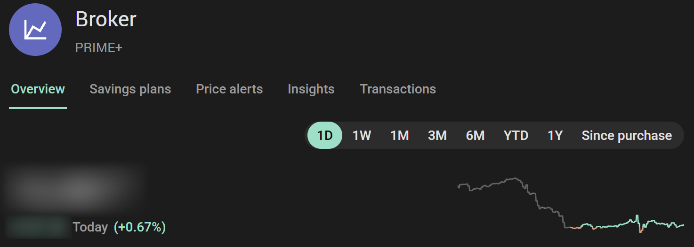

## Scalable Ticker card

The integration's second card: the securities one after another, for where a whole card is too much - across the top of a dashboard, in a narrow column, beside other cards. It comes with the integration the same way as the [Scalable card](#scalable-card), stands under **Scalable Capital Ticker** in the card picker and is suggested under **By entity** for the sensors of a position or a watchlist entry. In YAML it is just:

```yaml
type: custom:scalable-ticker-card
```

**Format** under **Settings → General** picks one of three:

- **Ticker** - one running line of all securities, without an end. It stops under the pointer.
- **Compact row** - one security at a time: logo, name, change, a small curve and the price. A swipe or a drag moves on.
- **Carousel** - tiles side by side, each with name, price, change, logo and a small curve.

Like the Scalable card, it **only shows**.

### What it goes through

**Shows** under **Settings → Content** says which securities:

- **Portfolio positions** - with a switch per group where groups are set up in Scalable's app, and one for the positions outside every group.
- **Watchlist** - a security that is also a position appears once.
- **Total value** - the portfolio as a whole in front of the rest: its value, its change over the chosen period and the curve of its return.
- **Securities** - a menu of everything the switches above let through, each with a tick. Untick the ones to leave out and apply. What Scalable adds to a list later appears by itself.

**Change over** names the period the change and the small curve cover, from **1D** to **1Y**; **Order** sorts by name, by value or by change. By value the positions come first and the watchlist entries follow by price.

### An entry

**What an entry shows** has a switch for each part: the [logo](#logos-and-short-names), the Market Insights sparkle in front of the name, the short name - AAPL for Apple - the name, the price, the change, and in the compact row and the carousel the small curve. **Position value** under the price shows what the whole position is worth in place of the price of one share; a security that is only on the watchlist keeps its price.

### The pop-up

A click on a security opens its page in a pop-up, the same page as in the [Scalable card](#a-securitys-page): the price with its change, the two prices of Scalable's **Sell** and **Buy** buttons, Market Insights, the chart over **1D** to **MAX** and **Your position**. **Pop-up** under **Settings → Content** has a switch for the logo, Market Insights, the chart, the two prices and your position. A click on the sparkle opens the page with the Market Insights summary over it, and the clock on a security with several open orders lists them under the page.

Arrows at the top of the pop-up, the arrow keys and a swipe lead to the next security, in the ticker's own order. A click on **Total value** opens the portfolio's [Insights](#insights) curve instead - **Total return** or **Portfolio value**, over **1D** to **MAX**.

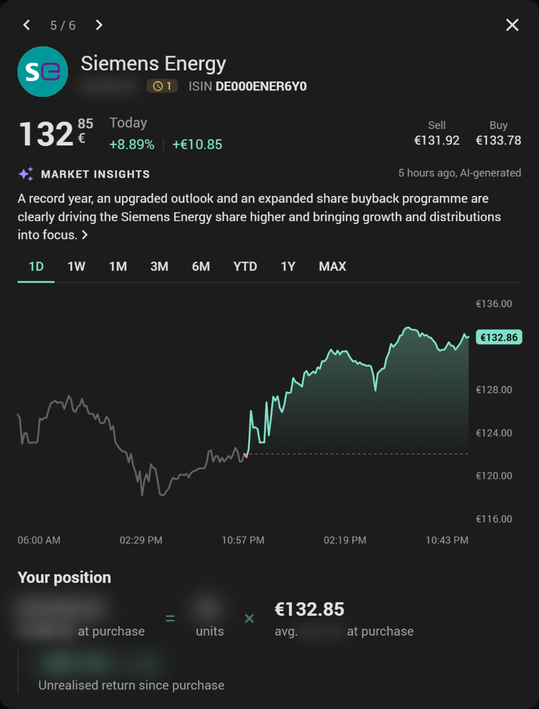

### How it moves

Under **Settings → Animation**:

- **Seconds per security** - how long one stands before the next, 2 to 120; in the running ticker and with the continuous glide, how long one takes to pass.
- **Endless loop** - after the last security the first comes again, without the run back to the start. On by default.
- **Move on automatically** - off, you go through the securities by hand. It pauses under the pointer and while the pop-up is open.
- **Effect** - for the compact row: slide, cross-fade, roll up, split-flap or zoom fade. For the carousel: slide, continuous glide, focus, staggered fade-in or coverflow. **Duration** sets how long a change takes, 100 to 3000 milliseconds.

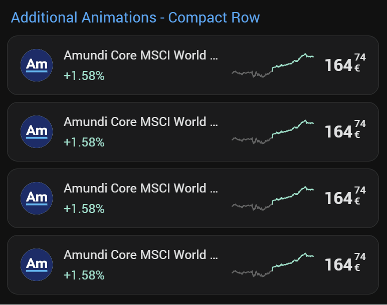 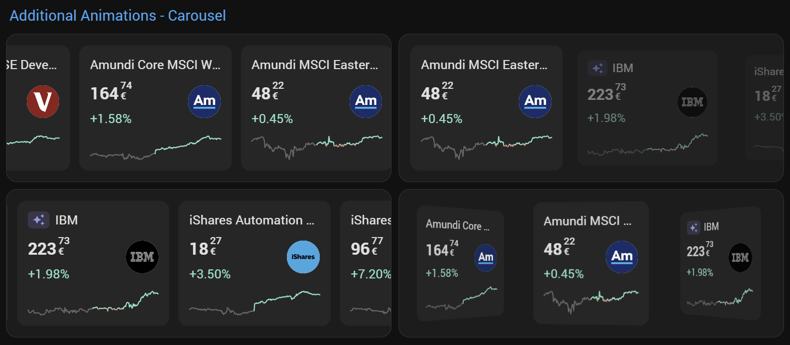

Where the device asks for less motion, the effects give way to the plain slide, and the running ticker stands still and is moved by hand.

With the keyboard, the running ticker and the compact row are one stop each: Enter opens the security in front, and the pop-up's arrows lead on from there.

### Settings

The editor is built like the Scalable card's, with two panels of three tabs:

- **Settings** - *General* (the format, the account, the period of the change, the order), *Content* (what the card goes through, what an entry shows, what the pop-up shows) and *Animation*.
- **Layout** - *General* (the card background, a background of their own for the carousel's tiles, the colours for gain and loss), *List* (the size of the logo, the sparkle's symbol and colours, and colour and font of the short name, the name, the price and the change - each only while its part is shown) and *Pop-up* (the name, the price, the Market Insights texts, the chart and the heading over your position).

Every field carries an **i** describing it, and only what you change is written to the dashboard.

## Reading only

Scalable's sign-in does not come in a read-only variety: what narrows it is the **access level** you set for Scalable MCP in your account (see [Before you start](#before-you-start)). On this side, the integration names eighteen of Scalable's tools - overview, positions, quotes, cash, watchlist, transactions, a transaction's details, price charts, price alerts, savings plans, portfolio list, portfolio groups, account profile, the overnight account and its transactions, the fixed-term accounts and a fixed-term account's details, and the news summaries behind Market Insights - and checks at every start and once a day that Scalable itself still declares each of them read-only. A tool that loses that declaration is not called at all.

## Logos and short names

Scalable names a security by its ISIN and hands out neither a logo nor the short name it trades under. The cards get the two from public services that need no account:

- **The logo** from [Parqet](https://www.parqet.com/)'s logo service.
- **The short name** - AAPL for Apple - from [OpenFIGI](https://www.openfigi.com/), which lists every exchange a security trades on. The integration picks one of them: for a stock a listing on one of the large US exchanges - a German stock excepted - else the exchange of its home country, else the German one; for an ETF the German one.

What leaves your Home Assistant for this is the **ISIN of each security a card shows** - nothing about you, your account or what you hold of it. It is Home Assistant that asks, not the browser: once per security, and the answer is kept for 30 days in Home Assistant's own storage, so the two services see one Home Assistant now and then rather than every open dashboard. A service that does not answer is left alone for a quarter of an hour.

The Scalable card asks for the securities whose logo it draws - the entries of its lists while **Symbol** under **Settings → List** is on, and a security whose page is opened. The ticker card asks for every security it goes through.

A security without a logo keeps a round symbol with its first letter, and Scalable's own ETFs carry Scalable's mark. The logos belong to their owners.

## Good to know

- **The one-day figures** are the last trading day against the close before it. On a weekend or a holiday the card names that day in place of *Today*.
- **Crypto** is counted in the portfolio's crypto value; single coins are not positions yet.
- **Every update** costs a handful of requests plus one per position, watchlist entry and fixed-term account. The card adds one request per security and period for its curves, kept for five minutes (one day) up to twelve hours (maximum), one per transaction page opened, and one per security an hour for Market Insights.
- Scalable MCP is a young interface. If Scalable changes it, this integration has to follow.

## Installation

Needs Home Assistant **2026.9** or newer.

### What you get

Three things, in one download:

- The **integration** itself.
- The **[Scalable card](#scalable-card)** and the **[Scalable Ticker card](#scalable-ticker-card)**. Served by the integration and handed to every dashboard, so there is no file to copy into `www` and no resource to register.
  After the first installation, load the dashboard page once - a page that is already open holds nothing of the card yet. From then on an update reaches every open page by itself: after Home Assistant restarts, the card checks which version is served and takes the new one over in place, with no reload and no cache to clear.

### Marketplace (HACS)

The recommended way. Scalable Capital is in the default list of the Marketplace - the store Home Assistant 2026.11 ships, HACS on earlier versions - so there is no repository to add:

[](https://my.home-assistant.io/redirect/marketplace_repository/?owner=somansch&repository=scalable&category=Integration)

1. Click the button above, or open Marketplace (HACS) in Home Assistant and search for "Scalable Capital"
2. Click **Download**
3. Restart Home Assistant

### Manual

Download `scalable.zip` from the [latest release](https://github.com/somansch/scalable/releases/latest) and extract it to `config/custom_components/scalable`:

```bash
mkdir -p custom_components/scalable
cd custom_components/scalable
wget https://github.com/somansch/scalable/releases/latest/download/scalable.zip
unzip scalable.zip
rm scalable.zip
```

A manual install needs no separate resource step for the card either: the integration serves it on every start.

## Help and Contribution

If you find a problem, feel free to open an [issue](https://github.com/somansch/scalable/issues) and I will do my best to help. If you have something to contribute, your help is greatly appreciated! If you want to add a new feature, please open a pull request first so we can discuss the details.

## Disclaimer

This custom integration is not officially endorsed or supported by Scalable Capital. Use it at your own risk, and make sure you comply with all relevant terms of service.

It talks to **Scalable MCP**, the interface Scalable offers for AI assistants, with your own sign-in and only through tools Scalable declares read-only. Figures it works out itself - purchase values, returns - can differ from Scalable's own, and what Scalable shows in its app is what counts.

**This is not investment advice.** The integration and its card only show what your own account holds; nothing in them, in this README or in its screenshots is a recommendation to buy, sell or hold anything. The securities that appear in the examples and screenshots - Caterpillar and Siemens Energy among them - are there to show how the card looks, not as a recommendation.

---

[](https://buymeacoffee.com/ou4lgpvlju)
